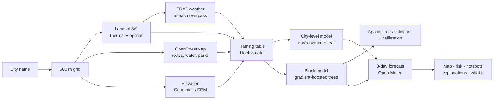

# LooMap: street-level heat risk for any city

**Live demo → https://loomap-xi.vercel.app** · try [`?city=Jaipur`](https://loomap-xi.vercel.app/?city=Jaipur), [`?city=Phoenix`](https://loomap-xi.vercel.app/?city=Phoenix) or [`?city=Cairo`](https://loomap-xi.vercel.app/?city=Cairo)

Heat module of **CrisisSense AI** · HeatShield AI, Challenge 02

Type any city. LooMap downloads real satellite, map and weather data, **trains a heat model in your browser**, and shows, for every 500 m block:

- **Where** it is hot: a surface-temperature map and statistically significant hotspots (Getis-Ord Gi*)
- **When:** a 3-day forecast with heat-risk levels
- **Why:** the factors pushing each block hotter or cooler
- **How sure:** a calibrated 80% confidence band
- **What if:** how much more tree cover or new development would change a block

No backend, no API keys, no paid services. It is one static page that runs on Vercel's free tier.

---

## Demo in 60 seconds

1. Open the link and click **Jaipur** (or search any city).
2. Watch the pipeline log: Landsat scenes download, the model trains, spatial cross-validation runs. Uncached, this takes about 10–60 s.
3. Read **Does it work?**: held-out error against three baselines.
4. Click a dark-red block to see its temperature, confidence band, hotspot status and **why it is hot**.
5. In **What if…**, set *More tree cover* to +30% and click **Apply to all hotspots**. The map and risk counts update.
6. Switch the layer to **Risk**, **Hotspots** or **Uncertainty**, and the day between the 3 forecast days.

> **Before presenting:** open each demo city once. Its data is cached in your browser, so it reloads in seconds even if a data server is slow.

## How it works



| Step | Details |
|---|---|
| **Collect** | The clearest Landsat 8/9 Collection-2 Level-2 scenes of the last 3 years (up to 8, spread across seasons) via Microsoft Planetary Computer. Clouds and shadows are removed with the QA band, and scenes are checked against their real (tilted) footprint. |
| **Engineer** | Per block: NDVI (vegetation), NDBI (built-up), open-water share, main-road density, distance to water, distance to parks/green, relative elevation, plus air temperature, humidity and wind when the satellite passed. |
| **Learn** | **Two parts.** (1) A city-level model predicts the day's average surface temperature from air temperature, and adds seasonal sun angle only if that predicts left-out dates better. (2) A **gradient-boosted tree model** learns how much hotter or cooler each block is than that average. It is written from scratch in JavaScript (`src/ml.js`): histogram splits, row subsampling, **monotone constraints** (more vegetation or water never raises heat, more built-up surface never lowers it) and quantile (P10/P90) models. |
| **Prove** | Spatial 4-fold cross-validation holds out whole neighbourhoods. It compares against three baselines (same-day city average, linear ridge model, greenery-only model) and reports MAE, R², hotspot F1 (overlap of the hottest 10% of blocks), split-conformal calibrated interval coverage and a monotonicity audit. |
| **Forecast** | Each block's latest surface state plus the Open-Meteo forecast at satellite overpass time gives predicted surface temperature for 3 days. Feels-like risk = forecast apparent-temperature max + 0.3 × the block's surface anomaly, banded with US NWS heat-index categories. |
| **Explain & act** | Per-block driver breakdown (tree-path attribution: contributions add up exactly to the prediction), Getis-Ord Gi* hotspots, and what-if sliders that re-run the model. |

### Why not LightGBM, SHAP and a server?

The original plan was LightGBM and SHAP in a Python dashboard. Running everything in the browser instead means:
- **any city works instantly,** with no pre-processing and no Earth Engine account;
- **it's free to host;**
- **judges can verify it,** because the model trains in front of them.

The engine implements the parts of LightGBM we needed (histogram GBM, monotone constraints, quantile loss) and uses tree-path attribution, a fast SHAP-style method.

## Results

Spatial cross-validation on real data (October 2026 runs, 576 blocks × 8 dates each):

| City | LooMap MAE | Linear model | Greenery-only | City average | Hotspot F1: LooMap vs average |
|---|---|---|---|---|---|
| Jaipur, India | **0.66 °C** | 0.86 °C | 0.98 °C | 1.00 °C | **0.49** vs 0.14 |
| Phoenix, USA | **0.76 °C** | 0.89 °C | 1.04 °C | 1.16 °C | **0.39** vs 0.04 |
| Cairo, Egypt | **0.90 °C** | n/a | n/a | 1.40 °C | n/a |

- The calibrated 80% band covers **80%** of held-out observations (target 80%).
- The physics audit finds **0 violations** in about 2,600 checks.
- What-if in Jaipur: +30% tree cover on the 81 hotspot blocks lowers surface heat by **0.8 °C**.
- The top drivers in both Jaipur and Phoenix are built-up surface, main-road density, vegetation and elevation.

## Run locally

Requires Node.js 18 or newer.

```bash
cd modules/heat/app
npm start          # serves the app at http://localhost:3000 (no install needed)
npm test           # 14 tests: ML engine + full pipeline on a synthetic city, no network
npm install        # once, for the build tool
npm run build      # writes dist/index.html: the single self-contained page that is deployed
```

Opening `index.html` by double-clicking won't work, because browsers block ES modules on `file://`. Use `npm start` or any static server (`python -m http.server`).

## Deploy

- **Vercel with Git:** import the repo, set **Root Directory** to `modules/heat/app` and **Framework Preset** to *Other*, with no build command.
- **Vercel drag-and-drop** (how the live demo is deployed): run `npm run build`, then drop `dist/index.html` onto the Vercel project page.

## Project structure

```
modules/heat/app/
├── index.html          # page layout and the "How it works" dialog
├── styles.css          # design (sandstone/terracotta palette, responsive)
├── src/
│   ├── data.js         # live data: Planetary Computer (Landsat), Overpass (OSM), Open-Meteo
│   ├── pipeline.js     # dataset, cross-validation, calibration, city-level model, forecast, risk
│   ├── ml.js           # GBM (L2 + quantile, monotone), ridge, metrics, Getis-Ord Gi*
│   └── app.js          # map (Leaflet), panels, what-if, CSV export
├── tests/              # node:test suites (npm test)
├── scripts/build.mjs   # bundles everything into dist/index.html
├── dist/index.html     # the deployed single-file build
├── package.json
└── vercel.json
```

## Limits and responsible use

- **A research prototype,** not a heat alert or a health warning.
- **Surface, not air.** Landsat measures surface temperature at about 10:30 local time, not the air temperature people feel or night-time heat. The 0.3 surface-to-air coupling used for risk is an assumption.
- **Daily level is the weakest part.** It is fitted on about 8 dates per city; its leave-one-date-out error is shown in the app (about 1.3–1.5 °C).
- **OpenStreetMap** is less complete in informal settlements, which are often the most heat-vulnerable. Its public servers can also be slow; after 45 s the app continues without OSM features.
- **What-if scenarios** change satellite indices, not real materials. Treat them as directional.
- **No personal data.** Nothing leaves your browser except requests to the public APIs below.

## Data and licences

| Data | Source | Licence |
|---|---|---|
| Landsat 8/9 C2 L2 (surface temperature, reflectance, QA) | USGS via Microsoft Planetary Computer | Public domain |
| Roads, water, parks | © OpenStreetMap contributors via Overpass API | ODbL |
| Elevation (Copernicus DEM), ERA5 weather, forecasts, geocoding | Open-Meteo | CC BY 4.0 |
| Basemap | Esri World Light Gray Canvas | Esri terms of use |
| Map library | Leaflet 1.9.4 | BSD-2 |
